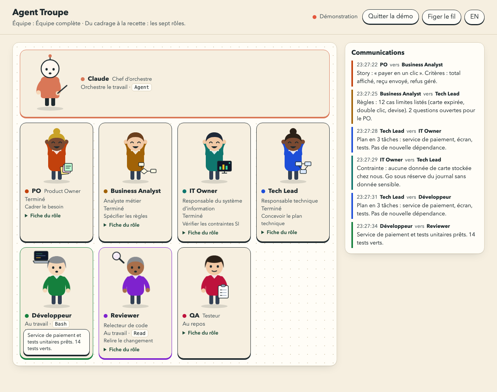

# Agent Troupe

**Voyez vos agents Claude travailler : une petite page web locale, des personnages animés, et le fil de leurs échanges.**
*See your Claude agents at work: a small local web page, animated characters, and the thread of their conversations.*



[Français](#français) · [English](#english)

---

## Français

Agent Troupe est un mod pour Claude Code. Il ouvre une page sur votre machine (`127.0.0.1`) où chaque sous-agent a son poste de travail et son personnage : il réfléchit, tape quand un outil tourne, lève les bras quand il a fini, et une enveloppe voyage d'un poste à l'autre à chaque message. Le fil de droite liste qui parle à qui.

### Les rôles

Sept rôles prêts à l'emploi, chacun avec une définition claire (ce qu'il décide, ce qu'il livre, ce qu'il ne fait pas) et un agent à déléguer :

| Rôle | Il décide | Il ne fait pas |
|---|---|---|
| **PO** (Product Owner) | Le besoin, les priorités, les critères d'acceptation | Choisir la technologie, écrire du code |
| **Business Analyst** | Le détail fonctionnel : règles de gestion, parcours, cas limites | Fixer les priorités, choisir la technologie |
| **IT Owner** | Les contraintes du SI : sécurité, conformité, budget, exploitation | Rédiger les stories, relire le code ligne à ligne |
| **Tech Lead** | L'architecture, le découpage technique, les arbitrages | Tout coder lui-même, valider le besoin métier |
| **Développeur** | L'implémentation d'une tâche cadrée, avec ses tests | Changer le périmètre, valider son propre travail |
| **Reviewer** | Si le code est lisible, correct, sûr et conforme | Réécrire le code à la place de l'auteur |
| **QA** (testeur) | Si le résultat satisfait les critères d'acceptation | Corriger les bugs, changer les critères |

Les rôles qui ne codent pas (PO, Business Analyst, IT Owner, Tech Lead, Reviewer) n'ont pas le droit de modifier de fichier.

### Modèles d'équipe

| Modèle | Rôles |
|---|---|
| `equipe-complete` (défaut) | Les sept rôles |
| `livraison` | Tech Lead, Développeur, Reviewer |
| `qualite` | Développeur, Reviewer, QA |
| `cadrage` | PO, Business Analyst, IT Owner, Tech Lead |
| `custom` | Vos propres rôles : `Rôle: mot-clé, mot-clé; Autre rôle: mot-clé` |

### Installation

```text
/plugin marketplace add AdamaDodoCisse/agent-troupe
/plugin install agent-troupe --marketplace AdamaDodoCisse/agent-troupe
```

Node.js 18 ou plus doit être installé (le petit serveur local n'a aucune dépendance).

### Utilisation

1. Tapez `/troupe` : la commande affiche l'adresse de la page et, pour chaque rôle, la phrase à copier pour lui confier une tâche. `/troupe open` ouvre la page dans votre navigateur.
2. Demandez à Claude de déléguer, par exemple : *« Utilise l'agent agent-troupe:tech-lead pour découper cette fonctionnalité, puis agent-troupe:developpeur pour l'implémenter, puis agent-troupe:reviewer pour la relire. »*
3. Le bouton **Démonstration** de la page rejoue un scénario de sept rôles sans rien lancer : pratique pour voir à quoi ça ressemble.

Un sous-agent est rattaché à un rôle par son type (`agent-troupe:qa`), sinon par le nom que vous lui donnez (`qa`, `testeur`, `tech-lead`, `développeur`…), sinon par la description de sa tâche. Les agents sans rôle apparaissent comme postes génériques.

### Configuration

Les options se règlent dans le menu de configuration des plugins de Claude Code :

| Option | Valeurs | Défaut |
|---|---|---|
| `template` | `equipe-complete`, `livraison`, `qualite`, `cadrage`, `custom` | `equipe-complete` |
| `roles` | Rôles du modèle `custom` | |
| `language` | `fr`, `en` (fiches de rôle et prompts des agents) | `fr` |
| `messageText` | `short` (140 caractères), `full` (1000), `none` (aucun texte) | `short` |
| `autoOpen` | `true` ouvre la page au démarrage de la session | `false` |
| `port` | `0` : un port libre est choisi à chaque démarrage | `0` |

### Confidentialité et sécurité

- **Tout reste sur votre machine.** Le serveur n'écoute que sur `127.0.0.1`, n'émet aucune requête sortante et n'envoie aucune télémétrie.
- **Ce que la page voit** : le rôle, l'état, le *nom* de l'outil en cours, une description courte de la tâche et le texte tronqué des messages entre agents. **Jamais** le contenu des fichiers, jamais les arguments des outils, jamais le prompt complet d'un sous-agent. `messageText: none` masque aussi le texte des messages.
- **Protections du serveur** : jeton aléatoire obligatoire (page et flux d'événements), contrôle de l'en-tête `Host` (rebinding DNS) et de l'`Origin`, politique de sécurité de contenu stricte (aucun script externe), corps de requête limité, mémoire limitée aux 500 derniers événements.
- Une panne du serveur ne gêne jamais votre session : le mod abandonne silencieusement l'envoi.

Voir [SECURITY.md](SECURITY.md).

### Limites connues

- **Ce que la page voit des échanges.** Avec l'outil `Agent`, un sous-agent ne parle pas aux autres : il rend compte à Claude. La page montre donc la **délégation** (Claude vers le rôle, avec la description de la tâche) puis le **retour** (rôle vers Claude, texte tronqué). Un échange direct de rôle à rôle n'apparaît que si des agents nommés s'écrivent avec `SendMessage` : ce cas est branché (événement `session.send`) mais **n'a pas encore été vérifié en conditions réelles**.
- Testé sous macOS avec Node 24 ; Windows, Linux et Node 18 à 22 ne sont pas encore testés.
- La page n'est pas rejouable après coup : elle ne garde que les 500 derniers événements de la session en cours.

### Vérifié en conditions réelles

Sur un vrai projet, sept sous-agents (`agent-troupe:po`, `ba`, `it-owner`, `tech-lead`, `developpeur`, `reviewer`, `qa`) ont été lancés dans une session. Le serveur a reçu 108 événements : chaque agent est arrivé à son poste, avec le bon rôle reconnu par son type, puis sa fin et son retour sont apparus dans le fil. Les agents avaient pour consigne de ne rien modifier.

### Développement

```bash
npm test                 # tests Node : serveur, rôles, réducteur d'état
npm run test:mod         # tests du mod (claude plugin test)
npm run validate         # claude plugin validate
TROUPE_DUMP=/tmp/troupe.jsonl claude --plugin-dir plugins/agent-troupe   # journal de debug des événements
```

La source unique des rôles est `plugins/agent-troupe/shared/roles.mjs` : modifiez-y une définition, un prompt ou un modèle d'équipe.

### Licence

[MIT](LICENSE)

---

## English

Agent Troupe is a Claude Code mod. It opens a page on your machine (`127.0.0.1`) where each subagent gets a desk and an animated character: it thinks, types while a tool runs, raises its arms when done, and an envelope travels between desks for every message. The feed on the right lists who talks to whom.

### Roles

Seven ready-made roles, each with a clear definition (what it decides, what it delivers, what it does *not* do) and an agent to delegate to:

| Role | Decides | Does not |
|---|---|---|
| **PO** (Product Owner) | The need, priorities, acceptance criteria | Choose the technology, write code |
| **Business Analyst** | The functional detail: business rules, journeys, edge cases | Set priorities, choose the technology |
| **IT Owner** | IS constraints: security, compliance, budget, operations | Write stories, review code line by line |
| **Tech Lead** | Architecture, technical breakdown, trade-offs | Code everything alone, validate the business need |
| **Developer** | Implementation of a framed task, with its tests | Change the scope, approve their own work |
| **Reviewer** | Whether the code is readable, correct, safe, compliant | Rewrite the code for the author |
| **QA** (tester) | Whether the result meets the acceptance criteria | Fix bugs, change the criteria |

Roles that do not code (PO, Business Analyst, IT Owner, Tech Lead, Reviewer) are not allowed to edit files.

### Team templates

`equipe-complete` (default, all seven), `livraison` (Tech Lead, Developer, Reviewer), `qualite` (Developer, Reviewer, QA), `cadrage` (PO, Business Analyst, IT Owner, Tech Lead), `custom` (your own: `Role: keyword, keyword; Other role: keyword`).

### Install

```text
/plugin marketplace add AdamaDodoCisse/agent-troupe
/plugin install agent-troupe --marketplace AdamaDodoCisse/agent-troupe
```

Node.js 18 or later is required (the small local server has no dependency).

### Use

1. Type `/troupe`: it prints the page address and, for each role, the sentence to copy to hand it a task. `/troupe open` opens the page in your browser.
2. Ask Claude to delegate, for example: *“Use the agent-troupe:tech-lead agent to split this feature, then agent-troupe:developpeur to implement it, then agent-troupe:reviewer to review it.”*
3. The page’s **Demo** button replays a seven-role scenario without running anything.

A subagent is matched to a role by its type (`agent-troupe:qa`), otherwise by the name you give it (`qa`, `tester`, `tech-lead`, `developer`…), otherwise by its task description. Agents with no role show up as generic desks.

### Privacy and security

Everything stays on your machine: the server listens on `127.0.0.1` only, makes no outgoing request and sends no telemetry. The page sees the role, the state, the *name* of the running tool, a short task description and truncated message text, never file contents, tool arguments or a subagent’s full prompt. A random token is required, `Host` and `Origin` are checked, the content security policy is strict, and a server failure never disturbs your session. See [SECURITY.md](SECURITY.md).

### Known limits

- **What the page sees of the exchanges.** With the `Agent` tool a subagent does not talk to the others: it reports to Claude. The page therefore shows the **delegation** (Claude to the role, with the task description) and then the **report** (role to Claude, truncated text). A direct role-to-role exchange shows up only when named agents write to each other with `SendMessage`: that case is wired (`session.send` event) but **has not been verified in real conditions yet**.
- Tested on macOS with Node 24 only. The page keeps only the last 500 events of the current session.

### Verified in real conditions

On a real project, seven subagents (`agent-troupe:po`, `ba`, `it-owner`, `tech-lead`, `developpeur`, `reviewer`, `qa`) were started in one session. The server received 108 events: each agent reached its desk with the right role (recognised from its type), then its end and its report appeared in the feed.

### License

[MIT](LICENSE)
